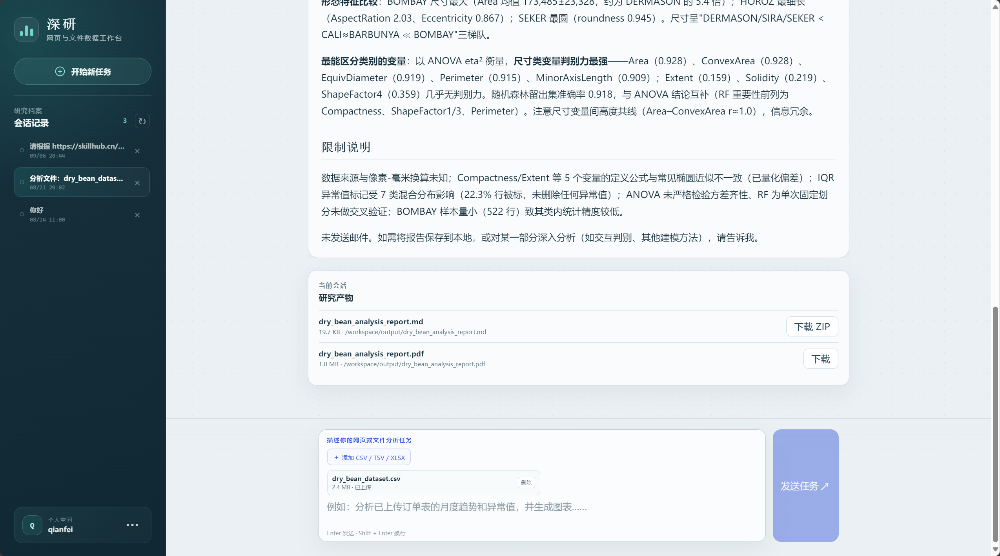

# Deep Data Research Agent

一个面向数据分析与资料研究的 AI 工作台。用自然语言描述目标，上传表格或提供网页链接，即可获得分析结论、图表和研究报告，并在同一界面查看执行进度与交付文件。



## 主要功能

### 数据分析

- 支持 CSV、TSV、XLSX 表格，也可分析已配置的 PostgreSQL 只读数据源。
- 按需求进行数据清洗、统计汇总、分组比较、趋势分析和异常检查。
- 生成图表、分析脚本和报告，保留可供核验的结果文件。

### 数据源与查询

- 从侧边栏打开「数据源与查询」，浏览已配置只读数据源中的表、字段说明和真实数据。
- 表列表与详情标题显示中文业务名称；可搜索表名与业务内容。
- 按字段设置文本、数值、日期范围和空值筛选，组合全部或任一条件，支持分页和选择显示列。
- CSV 导出使用已执行的筛选条件和当前显示列，导出全部匹配结果；超过部署配置的行数或大小上限时提示缩小范围，不静默截断。
- 查询直接使用只读数据库通道，无需配置模型或启动 Agent；数据库未启用或连接失败时页面提供明确提示。

### 网页与深度研究

- 搜索、抓取和整理公开网页，结合来源形成研究结论。
- 对复杂问题开展多轮检索、证据补充和冲突核验。
- 较长的采集任务可在后台执行，支持查看进度、补充要求和取消任务。

### 报告与文件交付

- 在对话中逐步展示分析过程与 Markdown 报告。
- 按需求生成 PDF 报告，并下载报告及配套材料。
- 部署方启用邮件功能后，可在用户确认后将报告发送到指定邮箱。

### 自定义 Skill

Skill 是可复用的任务方法与操作说明，用于让 Agent 按特定流程完成工作。

- 在对话中描述需求，或提供公开的 Skill 链接，创建、测试并分配给相应 Agent。
- 支持公共 Skill 与个人私有 Skill；同名时优先使用私有版本。
- 在「设置 → Skill 管理」查看私有 Skill 及所属 Agent。
- 同名私有 Skill 合并展示，确认删除后移除所有 Agent 下的私有副本，公共 Skill 保留。

Skill 变更从下一次 Agent 执行起生效。运行中的任务可能仍使用已加载内容；删除私有版本后，如有同名公共 Skill，会恢复使用公共版本。

### 记忆与个人设置

- 记录用户偏好和行为反馈，减少重复说明。
- 主 Agent 通过 `capture_user_memory` 提交固定字段或行为条目修改，工具校验后同步保存；MongoDB 版本条件更新避免并发覆盖，每轮运行仍加载最新记忆。
- 固定偏好使用 `field`、`value`（`null` 清除）；行为列表另指定 `action=add/replace/remove`，替换、删除时用完整 `old_text` 定位。用户记忆不再经过后台 LLM 整理，失败经验回顾继续在后台执行。
- 根据任务执行情况，后台整理可复用的失败经验。
- 可在设置中关闭自己的失败经验贡献，或清除个人偏好与行为反馈；会话、文件和 Skill 不受清除记忆操作影响。
- 登录后自行配置模型服务、模型名称和 API Key，并测试连接。

升级此记忆写入机制时，先停止旧版本 Agent 和记忆 Worker，避免旧写入路径与新版本并行。新版本会取消旧版未完成的用户记忆整理任务并清除其待处理原文，保留已保存的记忆；现有记忆记录无需批量迁移，首次更新会自动补上内部版本号。

### 研究工作台

- 会话历史与任务切换，支持继续已有对话。
- 流式回复、执行计划、后台任务状态和停止生成。
- 可切换详细模式，查看工具调用与子任务执行过程。
- 账户登录与个人空间，隔离用户的会话、文件和私有 Skill。

## 如何使用

1. 注册或登录，在设置中配置可用的模型服务。所选模型需要支持工具调用。
2. 上传数据、提供链接，或直接描述研究目标。说明关注的问题和期望的交付形式，有助于获得更合适的结果。
3. 查看执行计划与任务进度；长时间运行的后台任务可稍后继续查询。
4. 阅读结论、核对来源，并下载报告和配套文件。

可以这样发起任务：

> 分析这份销售表，比较各地区的月度变化，找出异常并生成图表。

> 对比这几家公司的公开产品资料，注明信息来源和无法确认的内容。

> 围绕这个主题做一次深度研究，交叉核验关键结论，并生成 PDF 报告。

> 创建一个每月销售复盘 Skill，测试后分配给数据分析 Agent。

## 本地启动

项目包含 Python 后端与 React 前端。本地运行需要准备 Python、uv、Node.js，以及 PostgreSQL、MongoDB、Redis、RabbitMQ 和 OpenSandbox 等依赖服务；网页检索还需配置相应服务凭据。

1. 复制根目录的 `.env.example` 为 `.env`，按模板完成环境配置和模型凭据加密密钥配置。
2. 按 [PostgreSQL 配置说明](docs/operations/postgres.md)、[Redis 配置说明](docs/operations/redis.md) 和 [RabbitMQ 配置说明](docs/operations/rabbitmq.md) 初始化依赖，并确认 MongoDB、OpenSandbox 可用。RabbitMQ 复用已有容器，默认 `guest/guest`，项目使用 `ddra` vhost。
3. 在 Windows PowerShell 中，从项目根目录启动开发环境：

```powershell
.\scripts\dev.ps1
```

默认访问 [本地工作台](http://127.0.0.1:5174)。开发脚本默认通过 WSL Debian 启动 OpenSandbox；其他环境请按实际部署调整。模型服务在登录后的设置中配置，完整环境选项以 `.env.example` 为准。不要提交真实凭据文件。

## 更多文档

- [项目结构](docs/architecture/project-structure.md)
- [架构设计](docs/architecture/design.md)
- [PostgreSQL 配置与维护](docs/operations/postgres.md)
- [Redis 配置与维护](docs/operations/redis.md)
- [RabbitMQ、任务重试与死信队列](docs/operations/rabbitmq.md)
- [PostgreSQL 数据源接入](docs/operations/postgres-mcp.md)
